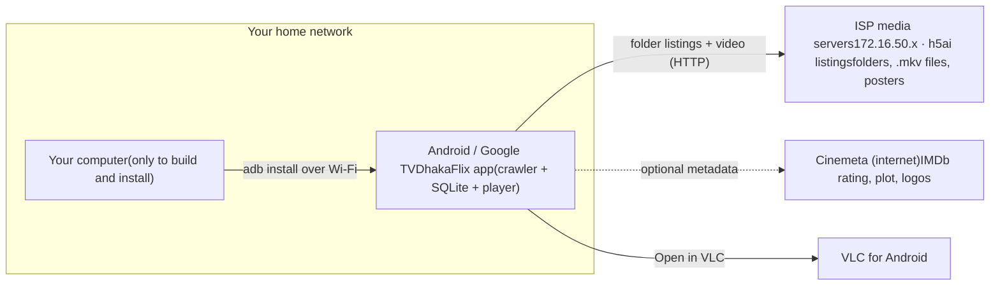

DhakaFlix guide

1. [Overview](#overview)
2. [1Survey the ISP server](#survey)
3. [2Install the toolchain](#toolchain)
4. [3Prepare the TV](#tv)
5. [4Create the project](#project)
6. [5Build the crawler](#crawler)
7. [6Add TV series](#series)
8. [7Ratings, plots, artwork](#metadata)
9. [8Build the TV interface](#ui)
10. [9Player and VLC](#player)
11. [10Build, install, speed up](#ship)
12. [11Test on the TV](#test)
13. [Adapting to your ISP](#adapt)
14. [Troubleshooting](#trouble)

Step-by-step build guide

# Turn your ISP's movie server into a Netflix-style TV app

Many ISPs (in Bangladesh, the BDIX/FTP servers such as DhakaFlix) give customers a local server full of movies and series, shown as plain folder listings. This guide builds a native Android TV / Google TV app that indexes that server and lets you browse it with posters, categories, search, ratings and resume, and play titles in a built-in player or VLC. It needs no server, account or always-on device.

**Time** 1–2 days the first time**Cost** free**Downloads** about 3 GB of tools, once**Result** a 4 MB app on your TV

Contents

1. [Overview](#overview)
2. [Survey the ISP server](#survey)
3. [Install the toolchain](#toolchain)
4. [Prepare the TV](#tv)
5. [Create the project](#project)
6. [Build the crawler](#crawler)
7. [Add TV series](#series)
8. [Ratings, plots, artwork](#metadata)
9. [Build the TV interface](#ui)
10. [Player and VLC](#player)
11. [Build, install, speed up](#ship)
12. [Test on the TV](#test)
13. [Adapting to your ISP](#adapt)
14. [Troubleshooting](#trouble)

## Overview

The app runs entirely on the TV. On first launch it crawls the ISP's folder listings into a small SQLite database, then rescans only folders whose date changed each time you open it. Posters come from the image file inside each movie folder. Ratings, plots, cast and backdrops come from Cinemeta, a free metadata service that needs no API key. Video streams straight from the ISP server to the TV over your LAN.



### What you need

| Item | Notes |
| --- | --- |
| Android TV or Google TV | Built-in TV OS, or a Chromecast with Google TV / Mi Box / Fire TV stick. This guide targets Android 11 (API 30) and newer. Tested on a Skyworth SWTV-22AE, 1920×1080. |
| A computer | macOS (used here), Linux or Windows, on the same Wi-Fi as the TV, with about 4 GB of free disk space. |
| An ISP media server | Reachable from your network, serving folder listings over HTTP. h5ai, Apache autoindex and nginx autoindex all work; step 1 tells you which you have. |
| VLC for Android | Optional. From the Play Store on the TV, as a fallback player for audio formats the TV can't decode (DTS, for example). |

**Why a TV app and not a website?**A web page can't read the ISP's listings (no CORS headers), Chrome on a TV won't switch the audio track in an .mkv, and Safari won't play .mkv at all. A web server also has to be running somewhere. A native TV app avoids all three: it reads the listings itself, Media3 plays .mkv files and switches Hindi/English audio, and nothing has to stay switched on except the TV.

## 1Survey the ISP server

Spend 30 minutes here before writing code. Everything later depends on how your server lays out its folders.

### 1.1 Find the categories

Open the ISP's portal page and list every category link. Most BDIX portals spread categories across several hosts.

```
curl -s http://172.16.50.7/ | grep -oE 'href="http://172[^"]+"[^<]*<' | sort -u
```

### 1.2 Identify the listing software

| If the HTML contains | It is | How to read a folder |
| --- | --- | --- |
| `_h5ai` and `fb-n` | h5ai | Parse the no-JavaScript fallback table: `<td class="fb-n"><a href=…>`, `fb-d` (date), `fb-s` (size in KB) |
| `Index of /` with `<pre>` lines | nginx autoindex | One `<a href>` per line, followed by date and size |
| `Index of /` with a table | Apache autoindex | Table rows with `<a href>`, last-modified and size columns |

**Pitfall: don't use h5ai's JSON API.**A POST with `{"action":"get","items":{"href":…,"what":1}}` looks convenient, but it returns every ancestor folder's contents too. For one movie folder that was 180 KB and about 5 seconds; a plain GET of the same folder was 2.6 KB in about 1.4 seconds.

### 1.3 Learn the folder naming

Walk a few categories down to a movie and write down the patterns. On DhakaFlix they were:

| Level | Example name | Kind |
| --- | --- | --- |
| Category | `English Movies/` | group |
| Year group | `(2026)/`, `(1995) & Before/`, `2001/` | group |
| Movie | `72 Hours (2026) 720p NF [Dual Audio]/` | title (holds one .mkv and a poster .jpg) |
| Ranked list | `001. The Shawshank Redemption (1994) 1080p/` | title |
| Show | `A Discovery of Witches (TV Series 2018–2022) 1080p/` | series, containing `Season 1/` … folders |
| Episode file | `… S01E05 1080p WEBRip ….mkv` | episode |
| Wrestling event | `AEW All in London (25-08-2024) 720p/` | title |
| Collection | `DC Extended Universe Collection (2008-2019)/` | group (year range, not a single year) |

The rule that falls out: **a folder whose name ends in a single year in brackets is a title; anything else is a group to walk into.**

### 1.4 Check streaming and codecs

```
# 206 Partial Content means seeking will work
curl -sI -H 'Range: bytes=0-100' "http://SERVER/path/movie.mkv" | head -3

# Which audio and subtitle tracks the files carry
ffprobe -v error -show_entries stream=index,codec_type,codec_name,channels:stream_tags=language \
  -of compact "http://SERVER/path/movie.mkv"
```

DhakaFlix files were H.264 or HEVC with two AAC tracks, Hindi first and English second, plus SRT subtitles. That's why the player prefers English (step 9).

**Be gentle with the server.**It's shared by every customer. On DhakaFlix, more than about 4 parallel requests pushed response times from 1 second to 16. Keep the crawler at 4 concurrent requests.

## 2Install the toolchain

You need Java 21, Android's command-line SDK tools, adb and Gradle. On macOS with Homebrew:

```
brew install openjdk@21 gradle
brew install --cask android-commandlinetools android-platform-tools
```

**Pitfall: Java 25 is too new.**Android's Gradle plugin needs JDK 17 or 21. Point `JAVA_HOME` at 21 for every build command.

every terminal session

```
export JAVA_HOME=/opt/homebrew/opt/openjdk@21/libexec/openjdk.jdk/Contents/Home
export SDK=/opt/homebrew/share/android-commandlinetools
```

```
yes | sdkmanager --sdk_root=$SDK --licenses
sdkmanager --sdk_root=$SDK "platforms;android-35" "build-tools;35.0.0" "platform-tools"
```

On Linux, install OpenJDK 21 and Android's command-line tools zip, then run the same `sdkmanager` lines. On Windows, Android Studio installs everything. Either way, note where the SDK lives for step 4.

### Gradle wrapper

Generate the wrapper in an empty folder so Gradle doesn't try to configure your project with the wrong version, then copy it in:

```
mkdir /tmp/wrap && cd /tmp/wrap && touch settings.gradle.kts
gradle wrapper --gradle-version 8.11.1
cp -R gradlew gradlew.bat gradle ~/dhakaflix-tv/
```

## 3Prepare the TV

1. On the TV, open **Settings → Device Preferences → About** and press **Build** 7 times.
2. In **Developer options**, turn on **USB debugging**.
3. Note the TV's IP address under **Settings → Network & Internet**.
4. From the computer, connect. The TV shows *Allow USB debugging?*: tick **Always allow** and press OK.

```
nc -z -G 3 192.168.0.227 5555 && echo open   # is network ADB listening?
adb connect 192.168.0.227:5555
adb devices -l    # should say "device", not "unauthorized"
```

**No "Wireless debugging" menu?**That menu is a phone feature that most Android TV 11 builds lack. On most TVs, USB debugging alone opens port 5555 after a moment. If it never opens, install the **Downloader** app on the TV, serve the APK from your computer (`python3 -m http.server`) and type its URL into Downloader.

## 4Create the project

layout

```
dhakaflix-tv/
  settings.gradle.kts   build.gradle.kts   gradle.properties   local.properties
  app/build.gradle.kts
  app/src/main/AndroidManifest.xml
  app/src/main/res/drawable-xhdpi/banner.png   (640×360, launcher banner)
  app/src/main/res/drawable-xhdpi/icon.png     (192×192)
  app/src/main/res/values/themes.xml
  app/src/main/java/com/dhakaflix/tv/
    Data.kt      categories, folder parsing, crawler, SQLite
    Meta.kt      Cinemeta metadata
    Ui.kt        theme tokens and shared components
    Screens.kt   drawer + tabs shell, Home, sections, search, detail
    Show.kt      seasons and episodes
    Player.kt    Media3 player
    MainActivity.kt  navigation
  app/src/test/java/com/dhakaflix/tv/ParseTest.kt
```

settings.gradle.kts

```
pluginManagement { repositories { google(); mavenCentral(); gradlePluginPortal() } }
dependencyResolutionManagement { repositories { google(); mavenCentral() } }
rootProject.name = "DhakaFlixTV"
include(":app")
```

build.gradle.kts

```
plugins {
    id("com.android.application") version "8.7.3" apply false
    id("org.jetbrains.kotlin.android") version "2.1.0" apply false
    id("org.jetbrains.kotlin.plugin.compose") version "2.1.0" apply false
}
```

gradle.properties · local.properties

```
org.gradle.jvmargs=-Xmx3g
android.useAndroidX=true

# local.properties (never commit)
sdk.dir=/opt/homebrew/share/android-commandlinetools
```

app/build.gradle.kts

```
plugins {
    id("com.android.application")
    id("org.jetbrains.kotlin.android")
    id("org.jetbrains.kotlin.plugin.compose")
}
android {
    namespace = "com.dhakaflix.tv"
    compileSdk = 35
    defaultConfig {
        applicationId = "com.dhakaflix.tv"
        minSdk = 30        // SQLite upsert (ON CONFLICT DO UPDATE) needs SQLite 3.24+
        targetSdk = 35
        versionCode = 1; versionName = "1.0"
    }
    buildFeatures { compose = true }
    buildTypes {
        release {   // what goes on the TV: ~4 MB instead of 70 MB, starts far faster
            isMinifyEnabled = true
            isShrinkResources = true
            proguardFiles(getDefaultProguardFile("proguard-android-optimize.txt"))
            signingConfig = signingConfigs.getByName("debug")   // personal sideload
        }
    }
    compileOptions { sourceCompatibility = JavaVersion.VERSION_17; targetCompatibility = JavaVersion.VERSION_17 }
    kotlinOptions { jvmTarget = "17" }
}
dependencies {
    implementation(platform("androidx.compose:compose-bom:2024.12.01"))
    implementation("androidx.compose.foundation:foundation")
    implementation("androidx.compose.ui:ui")
    implementation("androidx.compose.material:material-icons-extended")
    implementation("androidx.tv:tv-material:1.0.0")
    implementation("androidx.activity:activity-compose:1.9.3")
    implementation("androidx.media3:media3-exoplayer:1.5.1")
    implementation("androidx.media3:media3-ui:1.5.1")
    implementation("io.coil-kt:coil-compose:2.7.0")
    testImplementation("junit:junit:4.13.2")
}
```

AndroidManifest.xml (essentials)

```
<uses-permission android:name="android.permission.INTERNET" />
<uses-feature android:name="android.software.leanback" android:required="false" />
<uses-feature android:name="android.hardware.touchscreen" android:required="false" />
<application android:label="DhakaFlix" android:icon="@drawable/icon"
    android:banner="@drawable/banner"
    android:usesCleartextTraffic="true"          <!-- ISP servers are plain http -->
    android:theme="@style/Theme.DhakaFlix">
  <activity android:name=".MainActivity" android:exported="true"
      android:screenOrientation="landscape"
      android:configChanges="keyboard|keyboardHidden|navigation|orientation|screenSize|screenLayout|uiMode">
    <intent-filter>
      <action android:name="android.intent.action.MAIN" />
      <category android:name="android.intent.category.LAUNCHER" />
      <category android:name="android.intent.category.LEANBACK_LAUNCHER" />
    </intent-filter>
  </activity>
</application>
```

The `LEANBACK_LAUNCHER` category and the 320×180 dp banner (640×360 px in `drawable-xhdpi`) are what make the app appear on the Google TV home screen.

## 5Build the crawler

### 5.1 Declare your categories

Data.kt

```
class Category(val name: String, url: String, val series: Boolean = false) {
    val host = url.substringBefore("/DHAKA")
    val path = url.removePrefix(host)
}
val CATEGORIES = listOf(
    Category("English", "http://172.16.50.7/DHAKA-FLIX-7/English%20Movies/"),
    Category("Hindi", "http://172.16.50.14/DHAKA-FLIX-14/Hindi%20Movies/"),
    Category("TV & Web Series", "http://172.16.50.12/DHAKA-FLIX-12/TV-WEB-Series/", series = true),
    // … one line per category from step 1.1
)
```

Copy each URL exactly as the server encodes it (`%20`, `%28`, `%26`). The crawler matches child links by prefix, so a different encoding finds nothing.

### 5.2 Read one folder

```
class Entry(val href: String, val name: String, val dir: Boolean, val time: Long, val size: Long)

private val ROW_RE = Regex("""<td class="fb-n"><a href="([^"]+)">[^<]*</a></td><td class="fb-d">([^<]*)</td><td class="fb-s">\s*(\d*)""")

fun parseListing(path: String, html: String): List<Entry> {
    val fmt = SimpleDateFormat("yyyy-MM-dd HH:mm", Locale.US)
    return ROW_RE.findAll(html).mapNotNull { m ->
        val (href, date, kb) = m.destructured
        val rest = href.removePrefix(path).trimEnd('/')
        if (!href.startsWith(path) || rest.isEmpty() || '/' in rest) null   // skip parent and ancestors
        else Entry(href, URLDecoder.decode(rest.replace("+", "%2B"), "UTF-8"), href.endsWith("/"),
                   runCatching { fmt.parse(date)!!.time }.getOrDefault(0L), (kb.toLongOrNull() ?: 0L) * 1024)
    }.toList()
}
```

For Apache or nginx listings, swap `ROW_RE` for a regex over `<a href>` plus the date and size columns; the rest of the crawler is unchanged.

### 5.3 Tell titles from groups

```
private val MOVIE_RE = Regex("""^(?:\d{3}\.\s+)?([^(].*?)\s*\((\d{4})\)(.*)$""")
private val SHOW_RE  = Regex("""^(?:\d{3}\.\s+)?([^(].*?)\s*\((?:TV|Web)[^)]*?(\d{4})[^)]*\)(.*)$""", RegexOption.IGNORE_CASE)
private val EVENT_RE = Regex("""^([^(].*?)\s*\(\d{2}-\d{2}-(\d{4})\)(.*)$""")

/** null means "group folder: walk into it". */
fun parseTitle(name: String): Parsed? = parse(SHOW_RE, name) ?: parse(MOVIE_RE, name) ?: parse(EVENT_RE, name)
```

From the text after the year, pick up quality (`2160|1080|720|480p`) and whether it says "Dual" or "Multi" audio. Cover the real names in a unit test; it is the part most likely to break on another ISP:

ParseTest.kt

```
assertEquals(Parsed("72 Hours", 2026, "720p", true), parseFolder("72 Hours (2026) 720p NF [Dual Audio]"))
assertEquals("2.0", parseFolder("2.0 (2018)")?.title)                 // not a "001." rank prefix
assertNull(parseFolder("(1995) 1080p & Before"))                      // year group
assertNull(parseFolder("Alfred Hitchcock-Complete Filmography (1925-1934)"))  // collection
```

### 5.4 Walk incrementally

- **Group folders only.** The walk lists categories, years and collections. Title folders are recognised by name and stored without being opened, so the first full crawl of about 38,000 titles takes minutes, not hours.
- **Skip unchanged groups.** Store every group's modification time. A folder's date changes when something is added directly inside it, so on the next scan you re-list a group only when its date differs.
- **Open a title lazily.** The first time a poster is about to appear on screen, list that one folder, pick the largest video file and an image (prefer one named `_AL_`), and cache both in the database.
- **Mark and sweep.** Stamp each title with the scan's timestamp; after re-listing a group, delete its titles that weren't stamped. That removes films the ISP deleted.
- **Limit concurrency.** Use a `Semaphore(4)` for the walk and another 4 for poster lookups.

### 5.5 Database

```
CREATE TABLE movies(href TEXT PRIMARY KEY, parent TEXT, category TEXT, title TEXT, year INT,
  quality TEXT, dual INT, added INT, poster TEXT, video TEXT, size INT DEFAULT 0,
  position INT DEFAULT 0, duration INT DEFAULT 0, watched INT DEFAULT 0, seen INT DEFAULT 0, kind INT DEFAULT 0);
CREATE INDEX movies_cat_added ON movies(category, added);   -- every Home row and grid
CREATE TABLE dirs(href TEXT PRIMARY KEY, time INT);         -- group mtimes for incremental scans
CREATE TABLE progress(href TEXT PRIMARY KEY, show TEXT, position INT, duration INT, watched INT);
CREATE TABLE meta(href TEXT PRIMARY KEY, json TEXT);        -- cached Cinemeta data
```

**Pitfall: turn on WAL and add the composite index.**Without `setWriteAheadLoggingEnabled(true)`, the background scan's writes block the screen's reads. Without `(category, added)`, each Home row scans every title.

## 6Add TV series

Treat a show folder like a movie folder, with `kind = 1`. Don't crawl episodes ahead of time; list them when someone opens the show.

- **Seasons:** the subfolders of the show folder, in natural order (pad numbers so "Season 2" sorts before "Season 10"). If video files sit directly in the show folder, treat that folder as one season.
- **Episodes:** video files in a season folder, labelled from `S(\d{1,2})\s*E(\d{1,3})`.
- **Progress:** one row per episode URL in `progress`; position 0 with a duration means watched. Opening a show lands on the last watched season and offers "Resume S01E04" or "Play next: S01E05".
- **Auto-advance:** give the player the rest of the season as a playlist (step 9).

## 7Ratings, plots and artwork (optional)

[Cinemeta](https://v3-cinemeta.strem.io) is Stremio's free, keyless metadata service, based on IMDb. Two calls per title:

```
# 1. search; choose the hit whose releaseInfo starts with your folder's year
curl -s "https://v3-cinemeta.strem.io/catalog/movie/top/search=raakaasa.json"
# 2. details: imdbRating, description, genres, runtime, cast, director, background, logo,
#    and for series a videos[] list with season, episode, name, overview, thumbnail
curl -sL "https://v3-cinemeta.strem.io/meta/movie/tt36451817.json"
```

- Use `series` instead of `movie` for shows.
- Strip rank prefixes and dashes before searching: `"39 - Avengers-Endgame - Encore"` becomes `"Avengers Endgame Encore"`.
- New titles answer with a 307 redirect to `cinemeta-live.strem.io`; follow redirects.
- Cache the result (or `"{}"` for not found) per title forever, and fetch only after focus settles for about 350 ms, so scrolling past posters fires no requests.
- Say where the data came from: the app shows an IMDb badge on the rating and "Details: Cinemeta" on the movie page.

**Dark title logos.**Some logos are navy or black and vanish on a dark background. Sample the loaded logo's opaque pixels; if their average luminance gives under 3:1 contrast against the background, draw it with `ColorFilter.tint(white)`. Load logos with `allowHardware(false)` so the pixels can be read.

## 8Build the TV interface

Use Compose for TV (`androidx.tv:tv-material`). The layout follows the streaming-app standard: a side drawer, a top tab row, a hero for the focused title over a wide backdrop, poster rows, and grids per category.

### 8.1 The shell

```
ModalNavigationDrawer(drawerContent = { value -> Drawer(value, section, …) }) {
    Box(Modifier.fillMaxSize()) {
        holder.SaveableStateProvider(sectionKey) { /* Home, a section grid, or Search */ }
        TopBar(section, ::go)   // drawn on top, outside the swapped content
    }
}
```

**Pitfall: keep the top bar outside the content that switches.**If each screen draws its own tabs, switching section destroys the tab that has focus, focus falls into nothing, and the remote stops responding.

**Pitfall: keep the collapsed drawer short.**tv-material3's collapsed drawer clips its list instead of scrolling it. If the current section's item is off the bottom of the rail, pressing Left from the content won't enter the drawer at all. Show only the main destinations plus one "Categories" icon while collapsed, render the full list when open, and move focus to the current section once it opens.

**Pitfall: don't stretch the drawer.**A `fillMaxWidth()` child, such as a divider, makes the open drawer cover the whole screen. Give it a fixed width.

### 8.2 Tabs that switch on focus

Google TV switches tabs when you move onto them. Switch after about 280 ms of focus, and also commit the tab when focus leaves the row, otherwise a quick Down press loses the switch. Fade the row's trailing edge, and its leading edge while it's scrolled, so no label is cut mid-word.

### 8.3 Rows, grids and focus

- **Pivot scrolling:** provide a `BringIntoViewSpec` to the outer `LazyColumn` that returns `offset − headroom`, so the focused row snaps to the top instead of half-showing. Restore the default spec inside each row.
- **Focus memory:** save the focused card's key with `rememberSaveable` and request focus on it when the screen comes back, so Back from a movie lands on the same poster. Don't restore after a tab switch, or a card will steal focus from the tabs.
- **Off the UI thread:** a category with 33,000 titles takes a second or two to load. Query it on `Dispatchers.IO` through a small cache, and show "Loading…" meanwhile.
- **Focus treatment:** a 3 dp white ring plus a scale of 1.1. Give cards an opaque fill, or the focus glow shows through translucent ones.

### 8.4 Backdrop and legibility

- Anchor the backdrop top-right at 74% of the width and 16:9. Fade it to the background *inside its own bounds*, otherwise its lower edge shows as a hard line.
- Add scrims for the hero text on the left, the tab row at the top and the poster rows at the bottom. Keep hero text within about 500 dp so it stays over the dark side.
- Android 11 has no blur effect (`RenderEffect` arrived in Android 12). Decoding the poster at 36×54 px and stretching it reads as a heavy blur.
- Size text slots with `heightIn(min = lineHeight × lines)`, never a fixed height, so they survive larger font sizes.

## 9Player and VLC

Player.kt

```
val exo = ExoPlayer.Builder(ctx).build().apply {
    trackSelectionParameters = trackSelectionParameters.buildUpon()
        .setPreferredAudioLanguage("en")                       // rips list Hindi first
        .setIgnoredTextSelectionFlags(C.SELECTION_FLAG_DEFAULT) // subtitles off unless chosen
        .build()
    setMediaItems(queue.map { MediaItem.fromUri(it.url) }, startIndex, startPositionMs)
    prepare(); playWhenReady = true
}
// PlayerView (media3-ui) in an AndroidView: its controls already offer
// the audio track, subtitles and next episode, and work with the D-pad.
```

- **Progress:** save the position every 15 seconds and when leaving. Ignore positions under 10 seconds; over 95% counts as watched.
- **Auto-advance:** in `onMediaItemTransition` with reason `AUTO`, mark the previous episode watched.
- **Back:** the first press hides the controls; the second leaves the player.

Open in VLC

```
val i = Intent(Intent.ACTION_VIEW).setDataAndType(Uri.parse(url), "video/*")
    .setPackage("org.videolan.vlc").putExtra("title", title)
try { ctx.startActivity(i) } catch (e: ActivityNotFoundException) { /* ask the viewer to install VLC */ }
```

## 10Build, install and speed up

```
cd ~/dhakaflix-tv
./gradlew testDebugUnitTest assembleRelease
adb -s 192.168.0.227:5555 install -r app/build/outputs/apk/release/app-release.apk
adb -s 192.168.0.227:5555 shell cmd package compile -m speed -f com.dhakaflix.tv
adb -s 192.168.0.227:5555 shell am start -W -n com.dhakaflix.tv/.MainActivity | grep TotalTime
```

| Build | APK size | Cold start on the test TV |
| --- | --- | --- |
| Debug | 70 MB | about 10 s |
| Release (R8) | 4 MB | about 5.7 s |
| Release + `cmd package compile -m speed` | 4 MB | about 2.6–3.5 s |

Android compiles the app ahead of time by itself when the TV is idle; the `compile` command just does it immediately. Release builds aren't debuggable, so `run-as` won't let you read the database; log with `android.util.Log` instead.

## 11Test on the TV

**The TV is shared.**Before launching anything, check that nobody is watching: `adb shell dumpsys media_session | grep -m1 state=PlaybackState`. `state=3` means something is playing.

```
# drive the app with the remote's keys
adb shell input keyevent 19   # up      20 down   21 left   22 right
adb shell input keyevent 23   # OK      4  back

# screenshots: write to a file on the TV, then pull (exec-out output can be polluted by vendor logs)
adb shell screencap -p /sdcard/s.png && adb pull /sdcard/s.png

# larger-text check, then restore
adb shell settings get system font_scale
adb shell settings put system font_scale 1.3
adb shell settings put system font_scale 1.0
```

### Checklist

- First launch builds the library and Home rows fill in as categories finish.
- Moving onto a tab switches section; pressing Down quickly still switches.
- Left from any poster opens the drawer on the current section, including from the lowest category.
- Back from a movie returns focus to the same poster.
- The hero shows logo, IMDb rating, runtime, genres and plot after focus settles.
- Play starts in English; the audio and subtitle menus work; Back exits.
- Stopping halfway shows a progress bar and "Resume" on the movie page.
- A show opens on the last season watched, and the next episode plays by itself.
- Holding OK on an episode, or "Open in VLC", opens VLC.
- At font scale 1.3, nothing is clipped.

## Adapting this to your ISP

| What differs | Change |
| --- | --- |
| Server addresses and categories | `CATEGORIES`, and the tab groups (`SECTIONS`). |
| Listing software | `ROW_RE` and the date format in `parseListing`. |
| Folder naming | `MOVIE_RE`, `SHOW_RE`, `EVENT_RE`. Add your real folder names to the tests first. |
| Poster file name | The image preference in `resolve()`. |
| Audio language | `setPreferredAudioLanguage`, for example `"bn"` or `"hi"`. |
| Server tolerates fewer requests | Lower both `Semaphore` limits. |
| Older TV (Android 8–10) | Lower `minSdk` and replace the SQLite upsert with an insert-or-ignore followed by an update. |

Use this only for content your ISP provides to you as a customer. Keep the crawler gentle; the server is shared with every other subscriber.

## Troubleshooting

| Symptom | Cause | Fix |
| --- | --- | --- |
| Posters take 5–16 s | Too many parallel requests, or the h5ai JSON API | Plain GET of the fallback table; at most 4 requests at once |
| `adb connect` refused | Network ADB not open yet | Toggle USB debugging and wait; or use the Downloader app |
| "unauthorized" in `adb devices` | Prompt not accepted on the TV | Tick "Always allow" and press OK |
| Remote stops responding after a tab change | The focused tab was destroyed | Persistent top bar outside the switched content |
| Left doesn't open the drawer | Current item clipped in the collapsed rail | Short collapsed list; full list only when open |
| Open drawer covers the whole screen | A `fillMaxWidth()` child | Fixed width for dividers |
| Hard line under the backdrop | Screen-level scrim ends before the image does | Gradient inside the image's own bounds |
| Plot cut to one line at large text | Fixed-height text slot | `heightIn(min = …)` |
| Startup 6–10 s | Debug build, no ahead-of-time compile, no index | Release build, `cmd package compile`, `(category, added)` index, WAL |
| Movie plays in Hindi | Hindi is the first track | `setPreferredAudioLanguage("en")` |
| No sound on some files | DTS or another codec the TV can't decode | Open in VLC |
| No metadata for a new film | Cinemeta redirected (307), or not indexed yet | Follow redirects; results are cached once found |
| Navy or black title logo invisible | Dark logo on a dark background | Tint logos under 3:1 contrast to white |

Written from building the DhakaFlix TV app for a Google TV in Dhaka, November 2026: Kotlin 2.1, Compose for TV 1.0, Media3 1.5, Android Gradle Plugin 8.7. Newer versions may change names; the steps and pitfalls still apply.