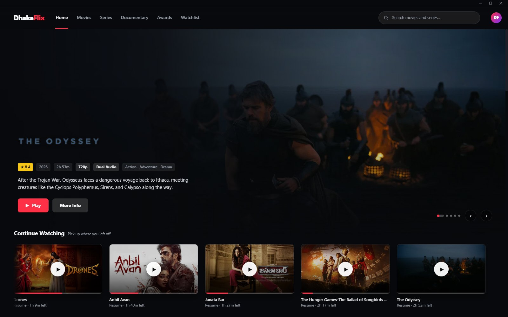
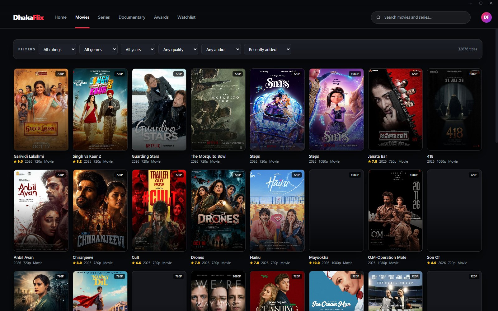
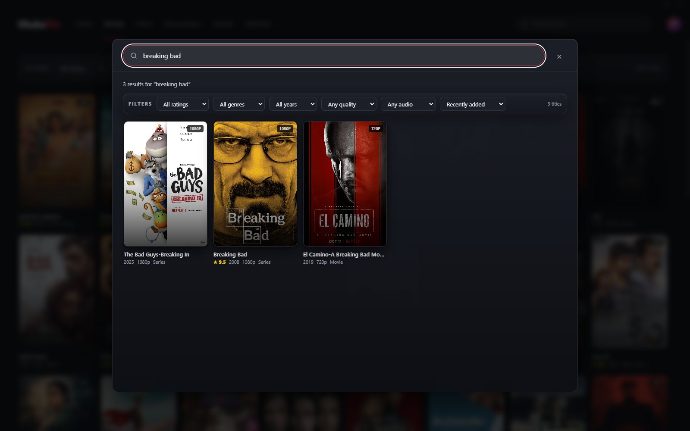
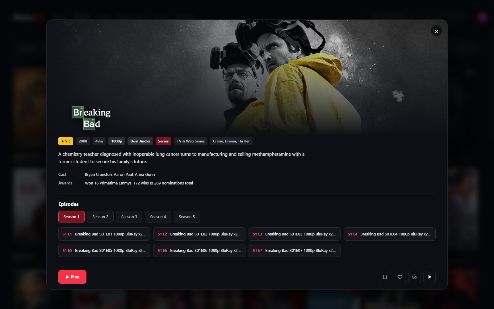

<div align="center">

# DhakaFlix PC

**Your ISP's media library, finally worth browsing.**

A Windows desktop client for BDIX / DhakaFlix media servers. Fast local catalogue,
Netflix-grade interface, and playback in the player you already trust.

[](https://github.com/mahbubzone/dhakaflix-pc/releases/latest)
[](https://github.com/mahbubzone/dhakaflix-pc/releases)
[](https://github.com/mahbubzone/dhakaflix-pc/actions/workflows/ci.yml)
[](#requirements)
[](LICENSE)

[Download](#installation) · [Features](#features) · [Screenshots](#screenshots) · [Development](#development) · [Docs](#documentation)

</div>



## Why DhakaFlix PC

ISP media servers hold thousands of titles, but their web indexes were never built
for humans. DhakaFlix PC turns that catalogue into a real library: instant search,
artwork, ratings, cast, trailers, seasons, and resume-where-you-left-off progress —
all backed by your own server, not a streaming subscription.

- **Local-first.** Titles, artwork, and progress live in a local SQLite database.
- **Player-native.** VLC or PotPlayer opens the stream directly. No embedded codecs,
  no re-encoding, no nonsense.
- **Private by design.** No accounts, no telemetry, no cloud. The app talks only to
  the BDIX servers you add and to GitHub for updates.

## Features

| | |
|---|---|
| 🎬 **Real catalogue** | Movies, series, documentaries, and award shows pulled from your ISP folders and indexed with full-text search. |
| 🔎 **Search that keeps up** | Instant full-text search in a modal, with the same rating, genre, year, quality, and audio filters as the grid. |
| 🍿 **Cinematic home** | Rotating hero built from live trending titles, continue-watching row, and curated rows per category. |
| 📖 **More Info** | Backdrop, original title logo, IMDb rating, runtime, cast, director, awards, genre chips, and trailer lightbox. |
| 📺 **Series aware** | Season switcher, episode grid, and per-episode progress. |
| ▶️ **External playback** | One click to VLC or PotPlayer, with resume timestamps read from your own watch history. |
| 🔄 **OTA updates** | GitHub Releases feed checks in the background and updates in place, keeping your library and settings. |
| ⌨️ **Keyboard-first** | `F11`, `/`, `?`, `Escape`, `Home`, `Ctrl+,` — designed to be driven without the mouse. |
| 🎛 **Settings** | Sources, library health, player detection, update channel, and About in one tabbed panel. |
| 🪟 **Frameless shell** | Custom 20 px window strip, hairline controls, and a layout that uses the whole screen. |

## Screenshots

| Browse the grid | Search without leaving the page |
|---|---|
|  |  |

| More Info modal |
|---|
|  |

## Requirements

- **Windows 10 (1903+)** or **Windows 11**, x64
- **VLC Media Player** or **PotPlayer** installed
- A connection to your ISP's BDIX network (`172.16.x.x`)

## Installation

1. Grab the latest `DhakaFlix-Setup-x.y.z.exe` from [Releases](https://github.com/mahbubzone/dhakaflix-pc/releases/latest).
2. Run the installer and follow the wizard.
3. Open **Settings → Sources** and add the folder URLs your ISP provides.
4. Run a scan, then start browsing.

> **SmartScreen note:** builds are unsigned, so Windows may show a warning.
> Choose **More info → Run anyway**. The installer is built from this repository
> by the public release workflow.

Updates arrive automatically from GitHub Releases. User data — sources, watch
progress, watchlist, favourites, cached metadata — survives updates and uninstall.

## Keyboard shortcuts

| Key | Action |
|---|---|
| `/` · `Ctrl+K` · `Ctrl+F` | Open search |
| `?` | Shortcut cheat sheet |
| `F11` | Toggle fullscreen |
| `Ctrl+,` | Open Settings |
| `Escape` · `Backspace` | Back / close overlay |
| `Home` | Return to Home |

## Development

### Prerequisites

- Node.js 20+
- npm 10+
- Windows (the installer target)

### Setup

```bash
git clone https://github.com/mahbubzone/dhakaflix-pc.git
cd dhakaflix-pc
npm install
npm run dev
```

`npm run dev` starts Vite, the TypeScript main-process watcher, and Electron together.

### Scripts

| Command | Description |
|---|---|
| `npm run dev` | Start the full development stack |
| `npm run build` | Typecheck, then build main, preload, and renderer |
| `npm test` | Run the unit test suite |
| `npm run test:coverage` | Unit tests with coverage |
| `npm run test:e2e` | Playwright end-to-end suite |
| `npm run dist` | Build the Windows NSIS installer |
| `npm run publish:win` | Build and upload to GitHub Releases |
| `npm run lint` | ESLint over `src` |
| `npm run typecheck` | TypeScript, no emit |
| `npm run icon` | Regenerate `build/icon.ico` |
| `npm run check-version -- v1.2.3` | Verify a tag matches `package.json` |

### Stack

- **Electron 28** main process with `better-sqlite3` (WAL + FTS5)
- **React 18 + TypeScript** renderer, bundled by **Vite**
- **electron-updater** for GitHub Releases OTA
- **electron-builder** NSIS packaging for Windows x64
- **Cinemeta** for metadata and trending artwork, cached in SQLite
- **Jest** unit tests, **Playwright** end-to-end tests

### Project structure

```
dhakaflix-pc/
├── src/
│   ├── main/        # Electron main process, IPC, scanner, database
│   ├── preload/     # Context bridge (window.api)
│   ├── renderer/    # React views, components, hooks, utilities
│   └── shared/      # Types shared across processes
├── build/           # App icon and packaging assets
├── docs/            # Architecture, decisions, planning, screenshots
├── scripts/         # Icon, version, smoke, and release helpers
├── test/            # Additional test fixtures
└── .github/         # CI and release workflows
```

### Releasing

Releases are cut by GitHub Actions and published straight to GitHub Releases,
which doubles as the OTA feed.

```bash
npm version 0.4.3 --no-git-tag-version
git commit -am "fix: v0.4.3 ..."
git push origin main
git tag v0.4.3
git push origin v0.4.3
```

The release workflow runs the tests, builds the installer, and uploads
`DhakaFlix-Setup-<version>.exe`, `latest.yml`, and the block map.
`scripts/check-version.js` fails the build when the tag and `package.json`
disagree, because electron-updater compares those versions.

Manual publishing needs a token with `repo` scope:

```bash
$env:GH_TOKEN = "ghp_..."
npm run publish:win
```

## Documentation

- [Architecture Overview](docs/architecture/ARCHITECTURE_OVERVIEW.md)
- [Database Schema](docs/architecture/DATABASE_SCHEMA.md)
- [IPC API Reference](docs/architecture/IPC_API.md)
- [Security Model](docs/architecture/SECURITY_MODEL.md)
- [Getting Started](docs/development/GETTING_STARTED.md)
- [Coding Standards](docs/development/CODING_STANDARDS.md)
- [Roadmap](docs/planning/ROADMAP.md)
- [Decision Log](docs/decisions/DECISION_LOG.md)

## Disclaimer

DhakaFlix PC is a browser and launcher for media servers on your own ISP network.
It does not host, include, or distribute any media. You are responsible for the
content you access and for complying with your ISP's terms.

## License

[MIT](LICENSE) © 2026 DhakaFlix
